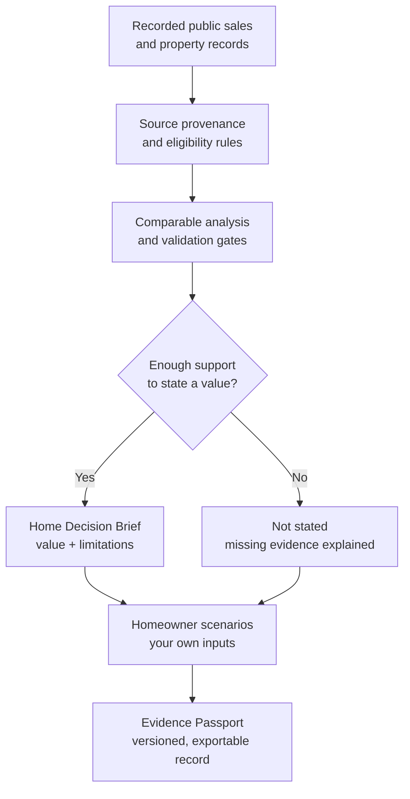

<div align="center">

# ascent.

### Your home is more than a number. Your decisions deserve the evidence.

**A home estimate should begin a conversation, not end one.**

Ascent is a **free, open-source home decision studio**. Investigate recorded sales, see how a valuation was calculated, challenge its assumptions, compare the financial consequences of your options, and keep a reproducible record of your reasoning.

**No account, subscription, or professional license is needed to explore the public pricing studios.**

**[Find your home](https://project-ascent-theta.vercel.app/#find-home)** · **[Try the interactive demo](https://project-ascent-theta.vercel.app/demo)** · **[See the published accuracy studies](https://project-ascent-theta.vercel.app/accuracy)**

[DC homes](https://project-ascent-theta.vercel.app/dc) · [Maryland homes](https://project-ascent-theta.vercel.app/maryland) · [DC condos](https://project-ascent-theta.vercel.app/dc/condos) · [My Home](https://project-ascent-theta.vercel.app/home) · [Free-service promise](https://project-ascent-theta.vercel.app/free)

[](https://github.com/topherchris420/project-ascent/actions/workflows/ci.yml) [](LICENSE) [](package.json)

</div>

---

> **The principle:** A recorded fact is not an assumption. An assumption is not an estimate. An estimate is not a guarantee. And an unknown should stay unknown.

## Start here

| I want to… | Start with… | What to expect |
| --- | --- | --- |
| Understand the evidence behind a **DC house** estimate | [DC Pricing Studio](https://project-ascent-theta.vercel.app/dc) | Eligible single-family and rowhouse records from a bounded public-data snapshot |
| Research a home in **Montgomery or Prince George's County, MD** | [Maryland Pricing Studio](https://project-ascent-theta.vercel.app/maryland) | Public-record comparisons; bedroom and bathroom counts are unavailable in this source |
| Explore a **DC condominium** | [Condo Studio](https://project-ascent-theta.vercel.app/dc/condos) | Unit-level recorded sales; the condo model **failed overall validation acceptance** |
| See the full experience without entering a real address | [Fictional interactive demo](https://project-ascent-theta.vercel.app/demo) | Illustrative Arlington home, real pricing mechanics, fictional evidence |
| Return to research I saved | [My Home](https://project-ascent-theta.vercel.app/home) | Local browser storage, with backup and restore; no account sync |
| Review the tests rather than the marketing | [Accuracy & validation](https://project-ascent-theta.vercel.app/accuracy) | Published holdouts, criteria, failures and limitations |

**A first visit in four steps:** choose a covered home (or the fictional demo), read the **Home Decision Brief**, inspect or change the comparable-sales assumptions, then explore decisions and export a **Property Evidence Passport**. No provider key is required for the bundled public studios.

**Jump to:** [What it does](#what-ascent-actually-does) · [Evidence flow](#how-the-evidence-flows) · [Accuracy](#published-accuracy-including-failures) · [Limits](#limits-that-matter) · [Privacy](#privacy-and-ownership) · [Local setup](#run-it-locally) · [Verification](#verify-the-work) · [Contributing](#contribute-to-the-evidence)

## What Ascent actually does

Ascent is designed for a homeowner asking more than *“What is my house worth?”* It also asks: *Compared with which sales? Under which assumptions? How trustworthy is the evidence? What changes if I sell, stay or rent?*

| Capability | What you can investigate | Important boundary |
| --- | --- | --- |
| **Home Decision Brief** | Seven plain-language answers about value, supporting sales, reliability, freshness, missing facts, choices, sensitivities and next steps | If evidence is inadequate, the answer is **Not stated**, not a made-up figure |
| **Explainable pricing** | Closed comparable sales, adjustments, weights, exclusions, source records, price and condition sensitivity | Adjusted-sale ranges are **not** automatically calibrated confidence intervals |
| **Homeowner Workbench** | Six ownership choices, cash flow, debt, equity, cash requirements and break-even points | User-supplied inputs; **illustrative, pre-tax arithmetic**, not forecasts |
| **Property Evidence Passport** | Save versions of evidence, assumptions, decisions and calculations; compare changes and export JSON or printable HTML | Private copies require care; browser storage is not encrypted or synced |
| **Ask Ascent** | Ask questions grounded in the brief's figures, calculations and source references | **AI does not set a home's price**; external model synthesis is gated |
| **Homeowner OS** | Property timeline, public-record watch, offer comparisons, decisions, transaction planning and selective agent sharing | Public functions are account-free; private transaction-room services require configured accounts |

### Make a number explain itself

A comparable is not simply a dot on a map. See which recorded sales qualified, what differs from the subject property, the explicit adjustments made, the weight each sale receives, and why a sale was excluded. Change a condition assumption, remove a questionable comparable with a reason, or examine another asking price. The calculation changes visibly; it is not replaced by an opaque AI opinion.

The **Home Decision Brief** puts conclusions before technical tables, but never hides their foundations. It separates **recorded fact**, **your assumption**, **computed figure**, and **unknown**. With fewer than three eligible recorded sales, or where release checks withhold a result, it declines to state a value. Additional public property facts, including permitted work and record freshness, are contextual information and do not silently alter the price model.

[Brief methodology](docs/home-decision-brief.md) · [Pricing design](docs/pricing-studio.md) · [Property data and freshness](docs/property-data.md)

### Follow the financial consequences

The workbench compares six choices **without ranking them**: **sell now**, **continue owning**, **rent out**, **renovate then sell**, **refinance**, or **buy another home while retaining this one**. You supply financing, costs, rent and other inputs. Missing figures remain unknown.

It shows 1-, 3-, 5-, 10- and 20-year calculations, tests one input at a time, and solves five break-even questions: selling versus holding price, property-value change, rent versus sale, zero-cash-flow vacancy and refinance rate versus keeping the current loan. These are calculations **conditional on your assumptions**, not predictions of home appreciation, loan eligibility, buyer behavior or renovation returns.

The choices do not imply equivalent housing outcomes. Taxes, replacement housing, financing availability and other personal circumstances are excluded from the core comparison.

[How the workbench calculates and abstains](docs/homeowner-workbench.md)

### Keep the history, not just the result

A **Property Evidence Passport** preserves the selected and excluded sales, changed inputs, checks, missing facts, report versions and next steps. The **Decision Time Machine** distinguishes changes in recorded comparable evidence from changes in your own assumptions.

Export a privacy-filtered JSON record or standalone HTML report and print it to PDF from your browser. On-demand evidence comparisons are **not** background listing searches or price alerts.

[Evidence history and replay](docs/evidence-and-decision-time-machine.md) · [Backup and restore](docs/homeowner-backups.md)

### A home has a workflow, not just a price

From a covered property's studio or **My Home**, open the **Homeowner OS** at `/home/{market}/{parcel}`.

| Area | Purpose |
| --- | --- |
| **My Property** | Read the brief and a dated property evidence timeline for recorded sales, permits, assessments, tax and flood information |
| **Market Watch** | Opt into browser-local checks of public records and newer nearby sales; checks occur when you use Ascent, not in the background |
| **Compare Offers** | Examine up to six offers, missing terms, cash-to-close or seller proceeds, dates, sensitivities and printable comparisons |
| **My Decisions** | Revisit the six-choice workbench and saved decision versions |
| **Transaction Room** | Manage milestones, deadlines, encrypted server documents, inspection items and notes in a private account workspace |
| **Share With My Agent** | Download a selective packet or use expiring, revocable invitations for chosen room content |

Offer analysis presents financial and term differences, **not a recommended winning offer, legal interpretation or predicted closing probability**. Unknown acceptance dates remain unknown, and conflicting dates are checked before calendar export. An MLS Bridge exists in code but remains **disabled without an agreement**.

[Homeowner OS and feature boundaries](docs/homeowner-os.md) · [Public-data permissions and refresh](docs/public-data-network.md) · [Account-security requirements](docs/account-security.md)

## How the evidence flows



**The pricing engine and homeowner financial calculations are deterministic.** Explaining evidence and computing a number are separate responsibilities. Records are shown with their provenance and date; uncertainties and failed checks travel with the result rather than disappearing between screens.

[Technical architecture](docs/engineering.md) · [AI architecture and gates](docs/ai-architecture.md)

## Published accuracy, including failures

**Do not mistake a plausible price for a validated price.** Ascent publishes retrospective, reproducible internal tests, including models that did not meet their acceptance criteria.

| Market / test | Held-out sales | Median absolute percentage error | Within ±10% of recorded price | Criteria met |
| --- | ---: | ---: | ---: | --- |
| **DC single-family and rowhouses** | 2,254 | **9.98%** | 50.2% | **9/9**; several narrow passes |
| **Montgomery + Prince George's, revised model** | 2,812 | **9.52%** | 52.0% | **8/9**; price-related bias failed |
| **DC condominiums** | 1,434 | **12.95%** | 41.16% | **4/9**; overall acceptance failed |
| **External Maryland study: four unserved counties** | 19,039 | **12.26%** | 42.49% | **5/9**; overall acceptance failed |

*Published internal holdout results as of October 21, 2026. Median error describes the group tested, **not** the likely error for any particular property. These are not independently certified results, appraisals or guarantees.*

What those numbers **do and do not** mean:

- **DC houses:** Only the unmodified, eligible validated configuration may show a calibrated interval. Custom assumptions or insufficient evidence remove that claim. Several criteria were met narrowly.
- **Maryland:** The revised model used a **different holdout** than the original failed study; the headline change is not a like-for-like improvement comparison. The price-related bias criterion still fails. No calibrated current-home interval is released.
- **DC condos:** Overall acceptance failed, and key building features such as HOA costs, floor, view, parking and amenities are not modeled. No calibrated interval is released.
- **Four-county external test:** The protocol was registered before those additional Maryland data were downloaded. Acceptance failed, so Ascent does not claim coverage there. The registered supplementary study supported both Home Decision Brief verdict-policy hypotheses: withheld cases had 16.8% median error, limited cases 13.1%, and supported cases 9.0%.
- **All studies:** Public records can lag, observed sales can be correlated, and an adjusted comparable-price envelope is not by itself a probability interval. **No independent replication has been completed.**

The [independent replication kit](docs/independent-replication.md) invites outside quantitative researchers to re-derive all published reports, inspect the protocols, evaluate methodological weaknesses and publish findings, including unfavorable ones. The [homeowner comprehension study](docs/usability/README.md) is registered but has **no participants or outcomes yet**.

**[Read the full accuracy report](https://project-ascent-theta.vercel.app/accuracy)** · [Validation methods and historical results](docs/valuation-validation.md) · [Release gates](docs/production-readiness.md)

## Limits that matter

Ascent is **not** an appraisal, brokerage, live MLS feed, tax or legal adviser, or autonomous transaction agent.

- **Geography:** Public address-based pricing covers eligible Washington, DC houses and condos, plus homes in Montgomery and Prince George's counties in Maryland. It is **not nationwide**. Virginia public-record pricing is unavailable pending written source-use permission.
- **What records cannot tell you:** Interior condition, concessions, title, current listings, unpermitted work, condo dues and reserves, and other decision-critical facts may be missing. A recorded permit does not prove work was completed. DC and Montgomery permit data are contextual, not direct price adjustments.
- **When the model declines:** Fewer than three eligible sales, or applicable release-gate failures, cause a **Not stated** value verdict. A withheld estimate stays withheld in the brief, offers, reports and sharing.
- **What a scenario is not:** Seller proceeds and ownership scenarios do not predict market response, timing, appreciation or returns. The app does not rank homeowner choices.
- **Source rights:** Public visibility and this repository's MIT license do **not** authorize redistribution of third-party MLS, vendor or restricted data. External providers need their own credentials, rights and review.

The goal is **inspectable uncertainty**, not manufactured confidence.

[DC coverage](docs/dc-public-records.md) · [Maryland coverage](docs/maryland-public-records.md) · [Condominium limitations](docs/dc-condominiums.md) · [Source and use permissions](docs/public-data-network.md)

## Privacy and ownership

For the public studios, **My Home** stores saved property decisions and additional financial inputs **in your browser**. You can save up to **10 homes and 10 versions per home**, subject to browser limits. This is not encrypted browser storage or cloud synchronization.

- **Back up and restore:** Export a private backup and preview restoration on another device. The backup contains **unencrypted** finances and notes; protect it. Exports made for reference are not automatically restorable backups.
- **Share deliberately:** Privacy-filtered JSON and HTML reports exclude private finances and notes by default. Choose a private export only when you intend to include them. Once a download is shared, it cannot be recalled.
- **Understand device risks:** Clearing browser data can erase local work. Anyone with access to a shared browser profile may access saved data. Export before deleting a home or switching devices.
- **Know the separate boundary:** Optional account-backed transaction rooms use server-side identity, encryption, tenant isolation and deployment requirements. Their security depends on correct production configuration.

[Browser storage and calculations](docs/homeowner-workbench.md) · [Backup design](docs/homeowner-backups.md) · [Production account security](docs/account-security.md)

## Free is part of the design

Public property research, basic comparable analysis, reports, and core client, offer and deadline workflows are committed to staying **free**, without a payment card or subscription. There are no current paid plans or new subscription checkout.

External data services, hosting and optional models have independent costs, permissions and quotas. Ascent will not silently charge you when a provider limit is reached, and an open-source license does not guarantee permanent hosted availability.

[Read the free-service promise](https://project-ascent-theta.vercel.app/free)

## Run it locally

**Requirements:** Node.js **24.x** and npm.

```bash
git clone https://github.com/topherchris420/project-ascent.git
cd project-ascent
npm ci
cp .env.example .env.local
npm run dev
```

Open **http://localhost:3040**. For Windows PowerShell, use `Copy-Item .env.example .env.local` in place of `cp`.

The bundled DC/Maryland studios, fictional demo and deterministic calculations do **not** need RentCast, Groq or OpenAI keys. Local workspaces use SQLite under the ignored `.data/` directory. A production account workspace requires PostgreSQL, migrations, configured account services and the documented security controls.

**Never commit** `.env.local`, `.data/` or provider credentials. Optional RentCast research and gated Groq/OpenAI integrations require authorized, server-side configuration.

[Engineering setup](docs/engineering.md) · [Provider integration](docs/rentcast-integration.md) · [PostgreSQL](docs/postgres-connection.md) · [Vercel deployment](docs/vercel-hobby.md)

## Verify the work

Ascent uses **Next.js 16, React 19, TypeScript and Node.js 24**. The calculation and data paths are testable without depending on a hosted AI model.

```bash
npm run typecheck
npm test
npm run validate:valuation -- --check
npm run build
npm run test:e2e
npm run replicate -- --quick
```

The browser suite requires Playwright Chromium to be installed and configured. CI also exercises offline domain and AI checks and a disposable PostgreSQL restore drill. **The existence of a test or workflow is not proof that the latest run passed or that deployment is production-ready.**

| Where to look | What you will find |
| --- | --- |
| `src/app/` and `src/components/` | Next.js routes and homeowner interface |
| `src/lib/` | Pricing, decision logic, provenance, account and data-service boundaries |
| `src/datasets/` and `evidence/` | Bundled research inputs and documented validation evidence |
| `migrations/` | Versioned database changes |
| `tests/` and `scripts/` | Automated checks, data tooling and reproducibility commands |
| `docs/` | Specifications, methods, permissions, threat boundaries and open work |

[Current CI](https://github.com/topherchris420/project-ascent/actions/workflows/ci.yml) · [Verification results](docs/verification-results.md) · [Capability matrix](docs/capability-matrix.md) · [Production-readiness checklist](docs/production-readiness.md)

## Contribute to the evidence

Contributions are welcome, especially in homeowner clarity, accessibility, documentation, reliable public-data provenance, permission-aware integrations, deterministic financial modeling and reproducible evaluation.

Two particularly valuable contributions need **independent people**, not another feature:

1. **[Replicate the valuation studies](docs/independent-replication.md).** Reproduce the figures, question the methodology and publish a signed assessment. Unfavorable findings are welcome.
2. **[Participate in or facilitate the homeowner comprehension study](docs/usability/README.md).** Help test whether real homeowners can distinguish estimates, assumptions, missing facts and risks. The study has not yet produced participant results.

Please preserve frozen evaluation records, dataset/source permissions, tenant isolation, privacy defaults and visible abstentions. Improve the model by testing it, not by hiding a failed metric. For substantial changes, open an [issue](https://github.com/topherchris420/project-ascent/issues) to discuss the evidence and expected behavior.

## Documentation map

| Topic | Primary reference |
| --- | --- |
| Product experience and homeowner reasoning | [Home Decision Brief](docs/home-decision-brief.md) · [Homeowner OS](docs/homeowner-os.md) |
| Estimation and historical validation | [Valuation validation](docs/valuation-validation.md) · [Independent replication](docs/independent-replication.md) |
| Property sources, permitted uses and freshness | [Property data](docs/property-data.md) · [Public-data network](docs/public-data-network.md) |
| Financial calculations and local history | [Homeowner Workbench](docs/homeowner-workbench.md) · [Backups](docs/homeowner-backups.md) |
| Engineering and security | [Engineering](docs/engineering.md) · [Account security](docs/account-security.md) |
| Evidence of completion and remaining gaps | [Verification results](docs/verification-results.md) · [Production readiness](docs/production-readiness.md) |

## License

Released under the **[MIT License](LICENSE)**. You can use, inspect, modify and distribute Ascent's code under its terms. **Third-party datasets, MLS content, API responses and services keep their own licensing, access and redistribution rules.**

---

<div align="center">

### The best real estate decision is one you can explain.

**[Open Ascent](https://project-ascent-theta.vercel.app/)** · **[Inspect the evidence](https://project-ascent-theta.vercel.app/accuracy)** · **[Explore the code](https://github.com/topherchris420/project-ascent)**

<sub>Open source. Evidence first. Your decision remains yours.</sub>

</div>
