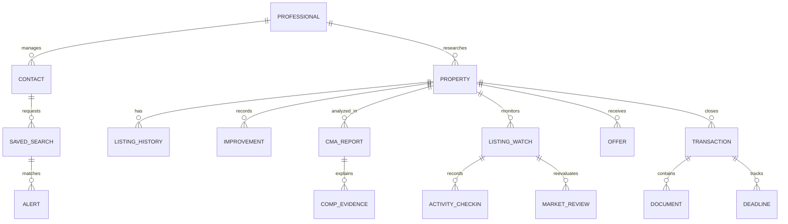

# Homesolo public reconstruction specification

Captured October 15, 2026. Evidence aliases H/P/I/J/M/B/V resolve to complete REA IDs in [evidence-ledger.md](evidence-ledger.md). The canonical record is [rea-final-bundle.json](../evidence/rea-final-bundle.json). The successor is an independent implementation; public sample source and visual assets are retained as investigative evidence only.

The public product exposes much more than a marketing homepage: `/demo` renders extensive sample CMA, reporting, CRM and listing-management screens. Those samples are explicitly fictional and wrapped in `inert` elements. They establish information architecture, content and intended workflows. They do **not** establish that those controls execute, how authenticated calculations work, or whether claims about model accuracy are true. No authenticated account or licensed data connector was available.

## Evidence classes

- **O — observed:** actual public page, state, response metadata or executed browser action.
- **S — sample:** an observed rendered demonstration of intended functionality, using explicitly fictional data. Execution and backend behavior remain unverified.
- **C — claimed:** published feature or policy description, not exercised in this investigation.
- **H — hypothesis:** a reconstruction inference or independent design choice, not a fact about Homesolo.
- **U — unknown:** insufficient evidence.

## Observable page and component inventory

| Page / location | Observable components and states | Evidence / status |
|---|---|---|
| `/` desktop | Brand/home link; anchors for Platform, CRM, Joy, Market review, audience, FAQ; demo, login and beta links. Large hero, illustrative pricing card, DMV/data coverage, Price→Analyze→Advise→Negotiate→Close journey, intelligence capabilities, Joy sample conversation, weekly listing review, CRM matching, offer structure, transaction deadlines, audience/beta sections, 11 FAQ disclosures, privacy/terms/contact footer and essential-cookie notice. | H, V; O for layout/content, C for features described. |
| `/` FAQ | Native `details`/`summary` disclosure. Clicking the CMA question revealed its answer; deterministic pricing and narrated AI are described separately. | H DOM, V `faq-open`; O interaction, C algorithm statement. |
| `/` mobile | At 390×844 brand and beta CTA remain in header; desktop navigation and login link are absent from accessible tree. Hero reflows to one column. Essential-cookie banner occupies the bottom of the first viewport. | M; O, one viewport only. |
| `/demo` outer page | Beta preview explanation, section anchor navigation, eight framed sample sections, email interest form, footer and cookie notice. No account/license required for preview. Every figure and the client document are labeled sample/fictional. | P; O. |
| Demo CMA workbench | Five in-page sections: recommendation, comparable sales, estimate, working, before listing. Save-CMA card, list strategies, asking slider, mortgage payoff, professional premium, adjusted comp plot/tables, failed listings, seller net plan, condition/renovation controls, confidence explanation, written letter, rent/cost checks, market snapshots, adjustments and comp overrides, improvement form and question input. | P; S. Inert preview. |
| Demo saved report | Property header, strategy and evidence first, seller plan, confidence, price-band clearing, narrative analysis, calculation waterfall, full comp evidence, rejected comps, print/PDF and presentation links. | P; S. Inert preview. |
| Demo client document | Print-styled article, address/date/professional identity/license, wider range, confidence/missingness, narrative, derivation table, professional-review disclaimer, prominent sample watermark. | P; S. Inert preview. |
| Demo CRM | Due/overdue follow-ups; Stage/Role grouping buttons; stages Lead, Active, Under contract, Closed, Lost; cards for buyer/seller/lender roles, email/phone and follow-up state. Fictional contacts use `example.com` and 555 numbers. | P; S. Inert preview. |
| Demo offer | Strength 82/100, Strong; price against estimate, financing, inspection, earnest money, closing flexibility. | P; S. Inert preview. |
| Demo listing timeline | Listing start/date/day, five strategy phases, skipped/recorded/upcoming check-ins, showing/second-showing/offer/feedback interpretation, reasons, hold/incentive options, seller cost/buyer benefit arithmetic and published loan-program contribution references. Evidence type is explicitly Observed / Modeled / Broker rule of thumb. | P; S. Inert preview. |
| Demo client alerts | Fourteen-day window, matches/near matches/status or price changes, time since event and Review links. | P; S. Inert preview. |
| Demo transaction deadlines | Inspection, appraisal, financing and settlement countdown. Urgent treatment described at 3 days, amber inside a week, gray otherwise. | P; S. Inert preview. |
| `/apply` | Email-only Notify me form; manual founding-group review; explicitly says there is no account to create yet. Demo link. Submission not attempted. | P; O. |
| `/login` | Email/password labels and autocomplete hints, Sign in, Forgot password, beta-application link, explanatory sidebar and cookie notice. Empty submit renders `Invalid email` and a schema-style password minimum-length error. No auth API request occurred on this blank submit. | P, V; O. Successful authentication U. |
| `/forgot-password` | Email, Send reset link, Back to sign in. No reset sent. | B; O. Delivery U. |
| `/privacy` | Policy updated October 14, 2026: data collected, processors, public property-record ingestion, MLS/AI boundaries, placeholders, exports/deletion and retention. | P; O document, C implementation. |
| `/terms` | Terms updated October 14, 2026: professional responsibility, MLS restrictions, fair-housing obligations, jurisdiction and accessibility aspiration. | P; O document, C enforcement. |
| `/crm/michael`, `/broker/clients/a`, `/broker/cma/sample-report/print`, `/help/condition` | Anonymous navigation to these exact public-demo-linked URLs redirected to `/login?redirectTo=<encoded original path>`. | B; O on these four paths only. |
| Other demo links | `/properties/sample/description`, `/broker/cma/sample-report/presentation`, remaining fictional CRM/client links. | P DOM; O link, destination U. |

The exact rendered headings, buttons, labels, tables and example values are retained in [demo-accessibility.txt](../evidence/demo-accessibility.txt), while complete markup and state digests are indexed in [capture-index.json](../evidence/capture-index.json). This is the exhaustive captured public component record; the table above groups repeated elements for review.

## Journey from acquisition to closing

1. **O:** Visit the landing page; explore public fictional CMA and workflow samples without an account.
2. **O:** Apply currently means leave an email on a manual interest form. The earlier copy saying sign up is not evidence of an accessible self-registration flow.
3. **C:** A team verifies license and MLS membership by hand; until approval the workbench stays locked. Access is aimed at licensed brokers, agents and salespeople in DC, Maryland and Virginia. Free founding beta starts when the verified workbench unlocks. Public post-beta pricing was not shown.
4. **O/U:** Existing users have email/password sign-in and reset entry points. No account, approved session, role, subscription or account provisioning was exercised.
5. **S/C:** An agent researches/adds a property and builds a CMA; compare recent sold/active/failed inventory and public property records, inspect model and missingness, adjust condition, search radius/window or comp choices, and enter professional judgment separately.
6. **S:** Compare conservative/moderate/aggressive list positions; explore historical pricing cohorts; inspect net proceeds and mortgage payoff. Preserve the evidence-supported value range when only asking price changes.
7. **S/C:** Save a report with written pricing explanation, access saved history, generate a printable client document or listing presentation. Demo copy says saving consumes a monthly CMA and narrative generation takes about half a minute; neither performance nor metering was tested.
8. **S/C:** Manage contacts, buyer criteria and saved searches; surface relevant matches, close matches and status/price changes with a concrete reason for follow-up.
9. **S/C:** List property; record staged check-ins and buyer response; review changing supply, competing inventory and absorption weekly. Agent decides whether to hold, reposition or offer an incentive.
10. **S/C:** Evaluate offers by terms; compare risks, draft counters and professional-reviewed communications.
11. **C/S:** Upload accepted contract, extract dates for professional review, track inspection/appraisal/financing/closing and send reminders. Public demo shows countdown cards, not upload/extraction execution.
12. **C:** Joy answers in page context throughout the journey. She may draft or suggest; the user reviews/sends and no price or record is changed automatically.

Registration-to-closing is therefore reconstructed as an intended journey with explicitly bounded observed segments. End-to-end original-product completion remains U.

## Property intelligence and CMA requirements

| Capability | Public evidence and reconstruction acceptance criteria | Class |
|---|---|---|
| Subject facts | Address, ZIP, size, bedrooms/baths, condition/renovation, improvements, assessor and permit context. Distinguish listing-supplied, public-record and professional-entered facts. | S/C |
| Geographic search | Demo describes a default quarter-mile radius and 12-month sold window, widened when necessary; entered radius and days rerun search. Record why selection widened. | S |
| Comp inclusion/exclusion | Demo groups 12 sales: 5 closest, 4 larger/better equipped, 3 smaller/less equipped. Closest full weight; larger/smaller half weight according to sample text. Shows added/manual comps and reasons for rejected sales. Selection weights from the actual engine remain U. | S |
| Adjustment explanation | Restate comps to subject attributes; display source sale and adjusted value; show each step's effect and running total, including excluded factors. Avoid treating public sample values as recovered coefficients. | S |
| Value vs list strategy | Sample estimated value $1.04M, recommended list $1,074,900, likely range $985K–$1.13M; three positions around $1.04M/$1.075M/$1.12M. These are invented figures, not MLS observations or validated forecasts. | S |
| Two ranges | Likely band described as middle half of adjusted comps; wider interval discussed as tested on past sales. The demo describes 80%-style historical coverage but presents no raw evaluation data. Do not inherit that calibration claim in the successor. | S/C |
| Asking-price simulator | Asking ±15% around recommendation, historical DOM/price cuts/sale-to-ask and under-contract cohorts. The copy explicitly notes sold-only selection bias and correlation. Demo slider remained unchanged under keyboard probes because it is inert. | S; execution U |
| Expert judgment | Professional premium amount and client-visible reason, explicitly separate from analysis. Outstanding mortgage affects net proceeds only. | S |
| Confidence | Data coverage, comp scarcity, search widening, property condition and difficult-to-comp warnings. Demo inconsistently shows 44% in workbench vs 57% in client document; treat as fictional fixture inconsistency, not an accuracy finding. | S |
| Subject prior sale/history | Past sale advanced by market and blended when 2–6 years old is a home-page claim. Prior failed listings shown as historical context rather than current ceilings. | S/C |
| Failed listings | Expired/withdrawn nearby inventory, last ask, $/SF, outcome and DOM; do not assume a failed ask is a hard value ceiling. | S |
| Public transfers | Off-market/FSBO records with source/date/distance; sample explains missing listing terms and excludes them from comp set. | S |
| Market-at-contract context | ZIP snapshots at estimated/actual contract dates, inventory, months supply, DOM and above-list share. Sample cites Redfin Data Center 90-day rolling windows independently of Bright. | S/C |
| Borrowing context | Rate at comp sales vs current mortgage rate and payment-equivalent budget change; shown as context without double-counting market changes in valuation. No live rate feed was observed. | S |
| Rental cross-check | Lease count, rent per square foot, implied monthly rent and annual multiplier. | S |
| Cost cross-check | Assessed land plus depreciated replacement cost; sample explicitly marks national construction-cost assumption unverified for current DMV conditions. | S |
| Improvements | Roof/HVAC/windows/water-heater/kitchen dated work with decaying cost-vs-value-style contribution, optional actual cost, public record age and source. Permit does not prove completion or quality. Sample text separates already embedded evidence from added improvements to avoid double counting. | S/C |
| Calculation and narrative boundary | FAQ claims deterministic pricing math; AI narration explains. Same inputs should reproduce same versioned calculation in the successor; this is an acceptance requirement, not a verified Homesolo algorithm. | C/H |
| Exports | Saved report, print/PDF client document and presentation route. The actual authenticated exports were not generated. | S |

## Market, client, offer and transaction requirements

| System | Public baseline | Original behavior coverage |
|---|---|---|
| Market monitoring | ZIP/price-band supply, absorption, DOM, reductions, pending/failed listings, competition and local trend; weekly re-read of watched listing. | Rendered samples + claims; schedule and alert accuracy U. |
| Listing check-ins | Days 1–3, 7, 15, 23, 30; phased plan through day 31+; showings, inquiries, second showings, offers, price/presentation feedback; warnings include observation vs modeled arithmetic vs broker rule of thumb. | Sample rendering only. |
| Seller scenarios | Commission input, net before/after mortgage payoff, price reduction vs seller credit, down-payment vs cash-at-closing effects; lender/program constraints require transaction confirmation. | Sample rendering only; published references not independently verified here. |
| Client profiles | Name, email, phone, role, stage, notes/activity, follow-up date; due follow-ups; buyer/seller/lender and pipeline views. | Sample rendering and privacy policy. |
| Saved searches | ZIP, price, bed/bath, sqft, type, neighborhood; near matches outside criteria; changes to shown properties. | Home claim, alert sample. |
| Alerts | New matches, near matches, pending/off-market/expired/withdrawn/price changes; agent receives details in app. | Home claim, sample. Delivery U. |
| Offer evaluation | Price relative to estimate, financing, contingencies/inspection, earnest money, closing flexibility, seller concessions, buyer-broker compensation and lengths; score, compare and counter draft. | Sample single offer and home claims. Exact score weights U. |
| Transaction | Contract upload/read execution/closing/contingency dates, milestones, deadlines, reminders, acceptance-to-closing continuity. | Claim plus four countdown samples. Document execution U. |
| Team utility | Shared billing/history for brokers/teams. Exact hierarchy, team permissions, invitations and cross-agent sharing U. | Home claim. |
| Settings/privacy | Machine-readable export and deletion at Settings → Privacy; owned records deleted on account deletion, counterparty records retained with link removed; sign-in logs 7 days, payment webhook records 90 days. | Privacy-policy claims; never executed. |

## Joy and contextual AI

H claims a floating bottom-right Joy button on every authenticated screen; context types are workspace, CMA, offer and transaction. It understands active figures so users can ask why a price was recommended, summarize before a meeting, identify offer risk, compare positions, ask what's due, find follow-up reasons and draft seller/buyer email or text. It is expected to give a short sourced answer linking back to the app and distinguish computed analysis from suggested judgment.

The public Joy conversation is illustrative, not a running chatbot. No AI request was made and the model, prompt, tool protocol, retrieval implementation, hallucination rate, latency and context completeness remain U.

The privacy policy says Anthropic inference receives abstracted summaries rather than MLS data; known saved names/emails/phones/addresses are replaced before inference and filled back on screen. Free text may not be replaced when unknown or misspelled. Conversation stays in tab storage and is cleared on sign-out/tab close; AI usage records retain occurrence/cost rather than question text. These are **C**, not verified traffic or storage claims.

Reconstruction requirements: explicit authorized entity context; source IDs and licensed-use flags; no raw MLS export to an unapproved model; placeholder/redaction boundaries including free text and uploaded documents; separate computed facts and model language; evidence links; missing-information responses; professional approval for consequential action. The successor's specific retrieval and structured tools are independent H design choices.

## Architecture, data and state boundaries

**Observed delivery (H/P):** Next.js App Router/Webpack script paths, React-style rendered markup, server-rendered HTML and `?_rsc=` prefetches. Public bundle route segments include `(marketing)` and `(auth)`. A Next.js Sentry client identifier and Sentry ingestion requests were present. Tailwind-like utility classes and focus styles appear in markup; this alone does not establish exact library versions or component authorship.

**Declared infrastructure (P privacy):** Supabase auth/application data; Anthropic inference; Bright MLS property feed and potential usage-monitoring script on licensed-data pages; Google geocoding; Stripe payments; Resend transactional email; Sentry; Upstash rate limiting/caching; Vercel hosting. Actual operational integration of these services, except public Sentry requests, is unverified.

**Manual static candidates (H response bytes):** shipped login bundle constructs a POST to `/api/auth/login` and chooses an admin/broker/dashboard destination from response `account_type`. Apply/demo construct POST `/api/demo/leads` with email/source. Shared sample bundles contain route strings for `/api/mls/comps`, `/api/mls/cma-letter`, `/api/mls/market-position`, `/api/broker/cma`, `/api/broker/cma/ask`, `/api/broker/manual-comps`, `/api/broker/listing-watches`, `/api/broker/listing-activity`, property facts/improvements/judgment and CRM contacts. See offsets/digests in [manual-static-endpoints.json](../evidence/manual-static-endpoints.json). No protected API call or server contract was verified. Do not infer authorization from route names.

**Likely conceptual relationships (H grounded in displayed fields):**

This is a conceptual reconstruction, **not** the recovered database schema. Record IDs, foreign keys, tenant hierarchy, SQL constraints, RLS policies, job mechanisms, storage buckets, idempotency, encrypted fields and audit design remain U.

Public-source ingestion is described as whole-government-file downloads matched on the server rather than per-user lookups. The privacy policy names DC tax/assessor/permit records, Maryland CAMA/recorded-sales files, Montgomery and Prince George's permits, and Fairfax/Arlington/Loudoun real-estate files. It claims owner/buyer/seller/applicant names are excluded. Home copy describes narrower DC-specific feature coverage; treat geography as source/feature-specific rather than assuming every jurisdiction has equivalent permits, costs and history.

## Responsive behavior and accessibility

O: named navigation regions, semantic headings/tables, labels on login, native FAQ disclosures, SVG/graph descriptions, focus-visible utility classes, toast/alert regions and native control semantics were captured. Login empty errors render inline. M confirms a single-column mobile hero and simplified header. The inert sample descendants still appear in REA's captured accessibility text; that text is not proof they are keyboard-usable.

C: terms state an aspiration to WCAG 2.1 AA. No full WCAG, screen reader, zoom, contrast, reduced-motion animation, focus-trap, keyboard-only authenticated task or horizontal-overflow audit was performed. Public evidence cannot support accessibility superiority claims. Potential usability differences to test in the successor include a visible mobile sign-in path, plain-language validation and navigable long-form CMA sections.

## Baseline capability matrix and evidence needed for superiority

The successor implementation and measured results are documented separately by the build task. This baseline deliberately makes no unverified implementation or superiority claim.

| Capability | Homesolo public baseline | Successor acceptance and comparison evidence |
|---|---|---|
| Authentication | Email/password form + redirects O; approved-account operation U. | Create/sign-in/session/logout and tenant-isolation integration tests; demo accounts clearly isolated. |
| Property research | Records/search/history/geographic comp context S/C. | Persisted subject records, filtered search, source/freshness, maps/history and provider status; licensed live data explicitly gated. |
| CMA | Extensive explainable sample S; actual deterministic engine C. | Versioned repeatable calculations, selected/rejected comps, adjustments/range/missingness, tests on known fixtures. Real accuracy/calibration needs licensed holdout outcomes. |
| Pricing simulator | Historical cohort asking-position sample S with selection-bias disclaimers. | Recomputed arithmetic, visible assumptions/evidence/uncertainty; no uncalibrated sale-odds forecasts. |
| Market intelligence | Weekly review C; listing activity/market interpretation sample S. | Durable snapshots and monitored changes with source time; deduplication and scheduler tests. Claims about alert usefulness require user evaluation. |
| CRM | Pipeline/follow-ups/role views S, buyer searches C. | Persisted clients/searches/activity and relevant match/near-match events, authorized CRUD tests. |
| Offers | Single strength sample S; comparisons/counter drafting C. | Editable structured terms, transparent net/risk comparison, professional-reviewed draft and audit events. Exact Homesolo score parity cannot be claimed. |
| Transactions | Deadline sample S; upload/extraction/alerts C. | Secure upload, reviewed extracted proposals, approved milestones, countdowns and reliable idempotent reminders. |
| Context AI | Detailed intended context/privacy/source behavior C, illustrative chat S. | Authorized entity evidence retrieval, fact-vs-judgment separation, citations, refusal on missing context, no automatic consequential action; grounding benchmark on test questions. |
| Reports | Saved report/client document/presentation sample S. | Deterministic useful export with provenance, watermark, version and review; render and content checks. |
| Decision graph | Connected workflows visible; explicit temporal graph U. | Source/time/confidence/use-policy edges and browsable decision lineage; differentiate only what is actually implemented. |
| Outcome learning | Demo mentions historical error/coverage C; methodology/data U. | Immutable forecast/outcome linkage, temporal holdouts, censoring/selection-bias controls and calibration metrics when legitimate data exists. Infrastructure alone is not learning improvement. |
| Team/security | Shared history/billing and RLS claims C. | Granular permissions, tenant isolation, secure file access, retention, rate limits and audit evidence. Production readiness still requires provisioned services and operational review. |
| Performance | No comparable original measurements collected. | Report local fixture measurements with hardware/build/dataset/sample size; never label local synthetic timings as real-market superiority. |

## Remaining investigation, in priority order

1. Owner-provided approved test account and licensed-data permission to exercise actual property search → CMA → report → client → offer → transaction. Stay within a designated test tenant.
2. Authorized source, migrations and service configuration to replace conceptual schemas and candidate endpoints with verified contracts. Fix the observed REA AST host/provider availability blocker before claiming static feature traces.
3. Licensed, versioned historical outcomes and cohorts to independently reproduce model error/range coverage, test temporal leakage and inspect selection/censoring. Sample backtest statements are claims only.
4. Verify real Joy requests with approved test context, redaction, source grounding, cost records and storage cleanup. Test missing, conflicting and stale evidence.
5. Run comparable original/successor task, performance, accessibility and reliability evaluations under equal conditions. Add verified differences to the capability matrix only after these tests.

The boundary is intentional: public reconstruction is substantial and evidence-backed; original private behavior remains unverified. Functional successor delivery can proceed against this acceptance baseline with clearly labeled synthetic data and independent documented algorithms.
